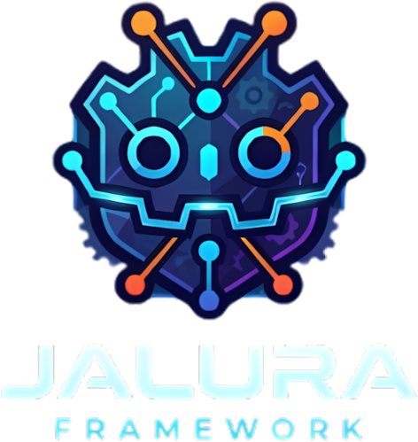

# Jalura Framework

A modular, data-driven Godot 4 framework for 3D diorama action-adventures and platformers: third-person character controller, diorama camera rig, interactive world objects, inventory, quests, save system, and built-in level-design editor tools — cleanly decoupled from game-specific content.



## Core Principles

- **Data-Driven:** Behavior is configured via Resources and Inspector properties, not rigid class inheritance.
- **Clean Rights & Provenance:** Zero copyrighted assets. All models, textures, shaders, and sounds are original or permissively licensed.
- **Modular Architecture:** Every module can be imported or used independently and instantiates cleanly in headless testing.
- **Production-Ready Tools:** Includes built-in editor docks for rapid level-design stamping, quest graphing, world map visualization, and automatic collision generation.

---

## Project Structure

```
addons/             Editor plugins (Jalura Toolkit, Collision Maker)
assets/             Original assets (Materials, Textures, Meshes, UI, Shaders)
docs/               Documentation and Architecture Map
resources/          Data resources (Items, Quests, World Map, Materials)
scenes/
  demo/             Playable demo level and ship cabin showcase
  items/            Pickable 3D item prefabs
  objects/          Interactive modular world objects (Chests, Doors, Levers, NPCs)
  player.tscn       Third-person player character controller
  ui/               Title screen, HUD, Inventory, Pause and Options menus
scripts/
  camera/           Diorama camera and cinematic camera rigs
  core/             Autoload managers (Save, Quests, Inventory, Audio/Settings, Transitions)
  data/             Resource definitions (ItemData, QuestData, Conditions, Objectives)
  interaction/      Modular interaction hub, behaviors (14+ components), and actions
  player/           Character movement, step climbing, water hazard, and equipment
  ui/               Menu logic and reactive HUD controller
  world/            Spawn points, rails, and scene controllers
```

---

## Getting Started

### Prerequisites
- **Godot Engine 4.3+** (Tested and verified with Godot 4.3 / 4.4 / 4.7)

### Running the Demo
1. Clone the repository:
   ```bash
   git clone https://github.com/your-username/jalura_framework.git
   ```
2. Open the project in Godot or run directly:
   ```bash
   godot --path .
   ```
3. The game boots directly into the 3D animated Title Screen (`scenes/ui/title_screen.tscn`). Click **"New Game"** or select a save slot to enter the **Jalura Demo Harbor**!

### Controls

| Action | Keyboard / Mouse | Gamepad |
|---|---|---|
| **Move** | `W` `A` `S` `D` | Left Stick |
| **Jump / Super Bounce** | `Space` | A / Cross Button |
| **Interact / Talk / Enter** | `E` | Y / Triangle or X |
| **Glider** (when equipped) | Hold `Space` in mid-air | Hold A in mid-air |
| **Grind Rail** (when equipped) | Jump onto rail tube | Jump onto rail tube |
| **Flashlight** (when equipped) | `F` | D-Pad Up |
| **Inventory & Items** | `I` | D-Pad Left |
| **Quest Log** | `Q` | D-Pad Right |
| **Equipment** | `U` | D-Pad Down |
| **Pause Menu / Settings** | `Escape` | Start / Options |

---

## Verification & Testing

Every module is covered by automated smoke tests and headless validation:

```powershell
# Import assets and generate class registry
godot --headless --path . --import
godot --headless --path . --quit

# Prefab smoke test (loads and instantiates all 32 scenes with 0 errors)
godot --headless --path . -s res://tests/smoke_prefabs.gd

# Player runtime test (physics, step climbing, animations)
godot --headless --path . -s res://tests/inspect_player.gd

# UI and inventory test
godot --headless --path . -s res://tests/runtime_ui.gd
```

---

## Editor Tools

### Jalura Toolkit (`addons/jalura_toolkit/`)
- **Asset Palette & 3D Stamper:** Instant 1-click placement and rotation of interactive props, NPCs, rails, and jump pads directly inside the 3D viewport.
- **Quest Studio:** Visual node graph for creating quest chains, objectives, and dialog trees.
- **World Map Graph:** Visual scene transition map showing doors, spawns, and connected rooms.
- **Live Validator:** Inspects active scenes for missing collisions, duplicate IDs, or broken links before export.

### Collision Maker (`addons/collision_maker/`)
- Right-click any `.glb` or `.obj` model in the FileSystem to generate a static scene with optimized convex, concave (trimesh), or box collision shapes. See [Collision Maker README](addons/collision_maker/README.md).

---

## License & Credits

- Code: MIT License.
- Assets: All models, shaders, textures, and audio are original or permissively licensed and safe for open-source use.
