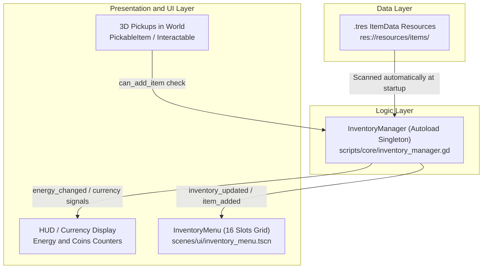
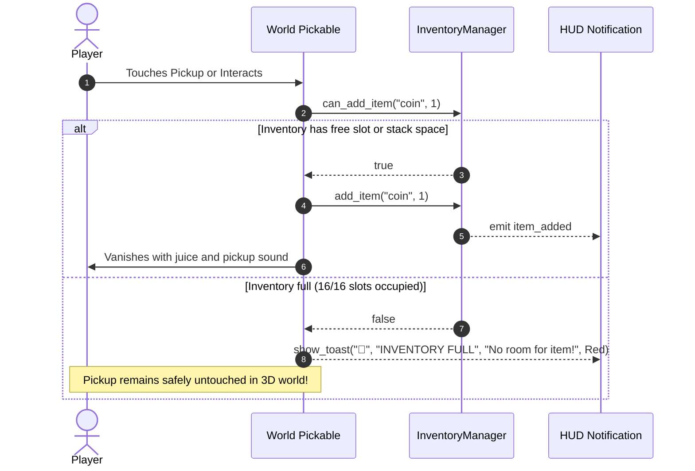

# 🎒 Inventory & Items

The inventory system in the **Jalura Framework** is built on a strictly **data-driven architecture** with a clean distinction between physical backpack inventory items and global currency attributes. New items can be created with zero code simply by authoring an [`ItemData`](../scripts/data/item_data.gd) resource (`.tres`).

---

## 🏛️ System Architecture

1. **`ItemData` (`Resource`):** Defines ID, display name, description, 2D icon, 3D model, category, stack limit (`max_stack`), and currency properties.
2. **`InventoryManager` (`Node` / Autoload):** Manages item dictionaries, counts, slot limits, currency synchronization, and persistence.
3. **`InventoryMenu` & `HUD`:** Visualizes items in the 16-slot bag grid or the persistent HUD counter bar.

---

## 🎒 16-Slot Backpack vs. Currency Counters

A central design pillar of the Jalura Framework is the **decoupling of currencies from physical items**:

| Feature | Physical Backpack Items (Apples, Tools, Keys) | Currencies (Energy / Coins) |
| :--- | :--- | :--- |
| **Category** | `CONSUMABLE`, `KEY_ITEM`, `TOOL`, `COLLECTIBLE` | `CURRENCY` (`is_currency = true`) |
| **UI Location** | 16-Slot Grid in [`InventoryMenu`](../scenes/ui/inventory_menu.tscn) (`[I]`) | Persistent HUD counter on screen |
| **Slot Consumption** | Consumes 1 of 16 slots (up to `max_stack`) | **0 Slots!** Never takes up backpack space |
| **Max Capacity** | Bound by `max_slots` (Default: 16) | Up to `max_stack` (Default: 999) |
| **Full Inventory Behavior** | Rejected (`can_add_item() == false`) | **Always collected**, even when all 16 slots are full |

> [!NOTE]
> The property `is_currency = true` causes `get_used_slots()` to ignore the entry. Power batteries or coins can always be collected without forcing the player to manage or dump inventory items.

---

## 🛡️ Full-Inventory Safety (Zero Item Loss)

Nothing frustrates players more than losing rare drops because their bag is full. The framework guarantees **zero item loss**:

---

## 🛠️ Creating New Items

### Method A: In FileSystem (Manual)
1. In the Godot FileSystem dock, right-click `res://resources/items/`.
2. Select **New Resource...** -> Search for **ItemData**.
3. Save as `gem_ruby.tres`.
4. Configure in Inspector:
   - **ID**: `gem_ruby` *(if left blank, uses filename as ID)*
   - **Name**: `Ruby Gem`
   - **Description**: `Glints brightly under the sunlight.`
   - **Category**: `COLLECTIBLE` or `KEY_ITEM`
   - **Max Stack**: e.g., `99`
   - **Can Drop**: `true`

### Method B: Using Jalura Toolkit (1-Click Item Converter)
1. In the top bar, open **Jalura Studio -> Tools**.
2. Select **1-Click Item Converter**.
3. Select any 3D model file (`.glb`). The tool automatically generates:
   - The `.tres` `ItemData` resource.
   - A ready-to-use pickable 3D scene in `res://scenes/items/pickable_<id>.tscn` with collision, pickup sound, and juice effects.

---

## 🔌 API Reference: InventoryManager

Available globally via the `InventoryManager` autoload:

### Methods

| Signature | Description |
| :--- | :--- |
| `can_add_item(item_id: String, count: int = 1) -> bool` | Checks if space is available (accounting for slots and currency status). |
| `add_item(item_id: String, count: int = 1) -> void` | Adds item, updates stack counters, and emits signals. |
| `remove_item(item_id: String, count: int = 1) -> bool` | Removes items; deletes key at 0. Returns `false` if insufficient items. |
| `has_item(item_id: String, count: int = 1) -> bool` | Returns whether at least `count` units are held. |
| `get_item_count(item_id: String) -> int` | Returns current quantity of an item. |
| `get_used_slots() -> int` | Returns number of occupied slots (excluding currencies). |
| `get_save_data() -> Dictionary` | Serializes items and currency values for SaveManager. |
| `load_save_data(data: Dictionary) -> void` | Restores inventory state from savegame. |

### Signals

| Signal | Parameters | Trigger |
| :--- | :--- | :--- |
| `item_added` | `item_id: String, count: int, total: int` | Emitted when an item is added to inventory |
| `item_removed` | `item_id: String, count: int, total: int` | Emitted when an item is consumed or dropped |
| `inventory_updated` | *(none)* | Emitted on any quantity or slot modification |
| `energy_changed` | `new_amount: int, delta: int` | Emitted when main energy currency changes |
