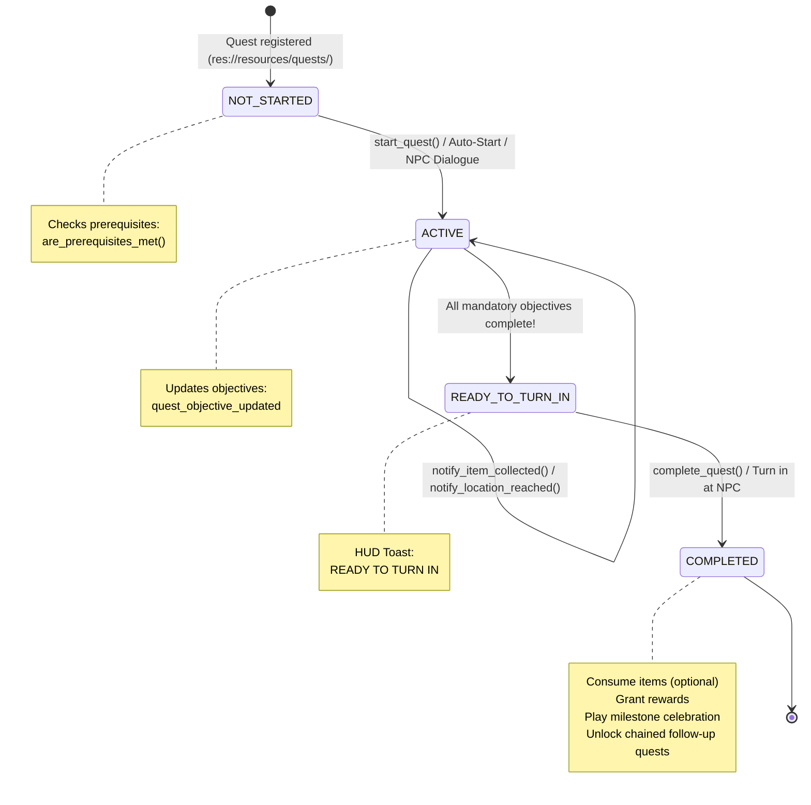
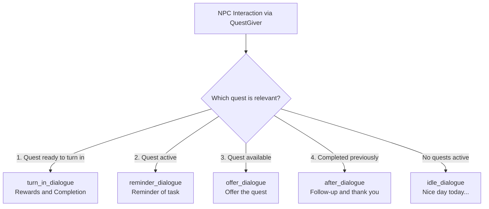

# 📜 Quest & Dialogue System

The quest system in the **Jalura Framework** is designed for production adventure gameplay: Fully **modular, data-driven, signal-based**, and tightly integrated with dialogues, inventory, and celebration staging.

Every quest exists as an independent [`QuestData`](../scripts/data/quest_data.gd) resource (`.tres`) in `res://resources/quests/`. Quests can be chained, gated by prerequisites, and managed visually through the in-engine **Jalura Quest Studio**.

---

## 🔄 Quest Lifecycle

Every quest transitions through a 4-state lifecycle machine:

### The Four States (`QuestData.QuestState`)
1. **`NOT_STARTED` (0)**: Known to the system, but inactive. Offered once all prerequisites (`QuestCondition`) are met.
2. **`ACTIVE` (1)**: The player is actively working on the goals. Events from the world and inventory update objective counters.
3. **`READY_TO_TURN_IN` (3)**: All required objectives are fulfilled. The quest awaits turn-in with the NPC.
4. **`COMPLETED` (2)**: Rewards distributed, victory celebration triggered, and state saved.

---

## 🎯 Objective Types

The system supports linear and non-linear tasks. When `sequential_objectives = true`, only the current objective in the list is active at any time.

All objectives derive from [`QuestObjective`](../scripts/data/quest_objective.gd):

| Objective Class | Purpose | Trigger in QuestManager |
| :--- | :--- | :--- |
| **`ItemObjective`** | Collect `X` units of `item_id`. Supports `consume_on_turn_in`. | `notify_item_collected(item_id, count)` or inventory sync |
| **`TalkObjective`** | Speak with NPC `npc_id`. | `notify_npc_talked(npc_id)` |
| **`LocationObjective`** | Reach a target area, room, or trigger `location_id`. | `notify_location_reached(location_id)` |
| **`InteractObjective`** | Activate switch, lever, or object `interactable_id`. | `notify_interaction(interactable_id)` |
| **`CustomEventObjective`** | Arbitrary gameplay events (`minigame_won`, `puzzle_solved`). | `notify_event(event_name, data)` |

> [!TIP]
> Objectives can be marked `optional = true`. Optional objectives do not block turn-in, making them ideal for bonus rewards or secrets.

---

## 💬 4-Phase Script Dialogue

NPC dialogues are directly integrated into quests. An NPC query delegates directly to [`QuestManager.get_npc_dialogue(npc_id)`](../scripts/core/quest_manager.gd):

Each string line in the array corresponds to one speech bubble or dialogue card in the HUD.

---

## 📺 HUD & Event Integration

The HUD responds in real-time to quest state changes:

### 1. Toast Notification Queue
Toasts slide down from the top center using smooth tweening. Multiple notifications queue automatically:
- **Quest Started:** `show_toast("🎯", "NEW QUEST", quest.title, Color.GOLD)`
- **Objective Updated:** `show_toast("🎯", "OBJECTIVE UPDATED", "Find 1 Coin (1/1)", Color.WHITE)`
- **Ready for Turn-in:** `show_toast("✨", "READY TO TURN IN", "Speak with Mara", Color.LIGHT_GREEN)`

### 2. Milestone Celebration Overlay
When completing a quest (`complete_quest()`):
- Player input is temporarily locked.
- A celebratory banner displays the quest title and rewards.
- Confetti particles rain across the screen.
- A 3D celebration stage displays the character performing a victory dance for `completion_dance_duration` (e.g. 3.5 seconds).

---

## 🔗 Prerequisites & Quest Chaining

Quests can depend on prior milestones via modular condition resources:
- **`QuestCompletedCondition`**: Specific quest `X` must be completed.
- **`QuestCountCondition`**: At least `N` total quests completed.
- **`ItemCondition`**: The player must hold specific items in inventory.
- **`FlagCondition`**: Global story flag must be set.

When a follow-up quest has `auto_start = true`, it activates seamlessly the moment the prior quest finishes.

---

## 🛠️ Jalura Quest Studio (Editor Tool)

Available in the Godot top dock under **Jalura Studio -> Quest Studio**:
- **Dependency Graph:** Visual node graph displaying all quests in `resources/quests/` and prerequisite links.
- **Quest Editor:** Form view for editing title, ID, categories, NPC links, sequential checkboxes, objectives, and dialogues.
- **Quick Wizard:** 1-click dialog to scaffold new fetch, messenger, exploration, or interaction quests.
