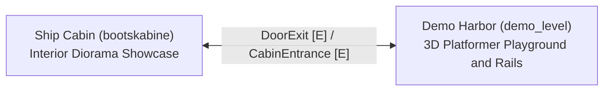

# 🗺️ World Map & Scene Navigation

The **Jalura Framework** uses a data-driven **symbolic scene registry and room routing architecture** ([`WorldMap`](../scripts/data/world_map.gd)).  
Instead of hardcoding scene file paths inside doors and transitions, levels refer only to symbolic string IDs (e.g. `demo_level`, `bootskabine`), which the engine resolves dynamically via `res://resources/world/world_map.tres`.

---

## 1. Scene Topology

---

## 2. Scene Registry (`resources/world/world_map.tres`)

Scenes are registered as [`WorldMapEntry`](../scripts/data/world_map_entry.gd) resources:

| Scene ID | Display Name | File Path | Scene Type | Registered Spawns |
| :--- | :--- | :--- | :--- | :--- |
| **`demo_level`** *(Start)* | Jalura Demo Harbor | `res://scenes/demo/demo_level.tscn` | 3D Playground | `default` (standard), `von_bootskabine` |
| **`bootskabine`** | Ship Cabin | `res://scenes/demo/ship_cabin.tscn` | Interior Diorama | `von_hafen` (default) |

---

## 3. How Transitions Work

1. **Player Interacts with Transition:**
   - Walking into a trigger zone (`obj_exit_zone.tscn`) or pressing `[E]` at a door (`obj_exit_door.tscn` / `door_trigger.tscn`).
2. **Transition Behavior Evaluates Locks:**
   - Evaluates key items (`key_item_id`) or story conditions (`lock_conditions`). If locked, displays a toast notification.
3. **Smooth Screen Fade:**
   - `SceneTransition` initiates a full-screen alpha fade.
4. **Scene Loading & Spawn Point Handshake:**
   - Loads the target scene file from `world_map.tres`.
   - Locates the `Marker3D` with matching `spawn_id`.
   - Places the character at the spawn coordinate and matches orientation.
   - Cleans up unused memory and fades back in.

---

## 4. Visual World Map Graph (Jalura Toolkit)

Accessible directly in the Godot top dock under **Jalura Studio -> World Map Graph**:
- **Automatic Graph Generation:** Scans all registered scenes for spawn points (cyan inputs) and transition exits (green/orange outputs).
- **Persistent Layout:** Drag nodes freely across the canvas; positions save automatically to `resources/world/world_map_layout.json`.
- **1-Click Scene Open:** Click **"Open in 3D"** on any graph card to load the scene directly into the Godot viewport.
