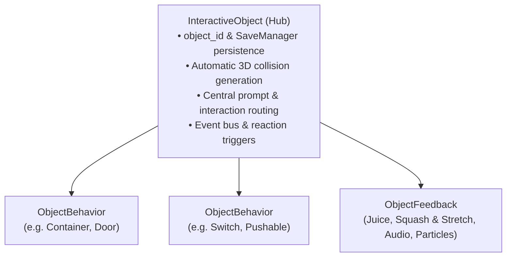

# 📦 Modular World Object System

Welcome to the comprehensive guide for the modular interactive world object system in the **Jalura Framework**!  
This system replaces rigid, hardcoded object logic with an extensible building-block toolkit based on the **Hub-and-Spoke Pattern**. Any object in the 3D world can be composed of modular components or dropped directly into scenes as a pre-configured prefab.

---

## 1. Architecture Overview

### The Hub-and-Spoke Principle

1. **`InteractiveObject` (Hub):**
   - The root node of any interactive entity ([`scripts/interaction/interactive_object.gd`](file:///c:/Users/janlu/Desktop/projekte/jalura_framework/scripts/interaction/interactive_object.gd)).
   - Manages a unique `object_id` for persistence via `SaveManager`. If left blank, automatically derives a clean, unique ID from the node name.
   - Manages collision modes (`collision_mode`).
   - Automatically detects all child `ObjectBehavior` nodes and routes interactions based on their `interaction_priority`.
2. **`ObjectBehavior` (Component Modules):**
   - Distinct capabilities that can be attached to any object (e.g. `ContainerBehavior`, `DoorBehavior`, `PushableBehavior`, `NPCBehavior`, `BouncePadBehavior`, `SwitchBehavior`, `WobbleBehavior`).
   - Each behavior defines its own persistence methods (`get_save_state()` / `load_save_state()`), bundled automatically by the hub.
3. **`ObjectFeedback` (Juice Component):**
   - Listens to hub events (`opened`, `toggled`, `shaken`, `pushed`, etc.) and plays elastic animations (squash & stretch), in-range scale hops, pitch-randomized 3D audio, and particle puffs.
4. **Triggers & Actions (`ObjectTrigger` & `ReactionAction`):**
   - Enables event-driven reactions without code (e.g., *"When switch is activated $\rightarrow$ open gate right"*, or *"When chest opened $\rightarrow$ trigger toast message"*).

---

## 2. Pre-Configured Object Prefabs

The framework provides modular, ready-to-use prefabs in `res://scenes/objects/`. All essential settings are exposed **at the root node in the Godot Inspector**:

| Prefab | Root Class | Typical Usage | Key Inspector Properties |
| :--- | :--- | :--- | :--- |
| **`obj_sign.tscn`** | `ObjSign` | Signs, bulletin boards, letters, books | `title`, `lines` (multiline text), `prompt_text` |
| **`obj_chest.tscn`** | `ObjChest` | Chests, cupboards, crates, barrels | `contents` (items & counts), `is_locked`, `key_item_id`, `consume_key` |
| **`obj_pickup.tscn`** | `ObjPickup` | Ground items, coins, quest collectibles | `item_id`, `amount`, `auto_bob` (floating bob), `disappear_on_pickup` |
| **`obj_shakeable.tscn`** | `ObjShakeable` | Trees, bushes, vending machines | `drop_item_id`, `drop_amount`, `max_drops`, `shake_cooldown` |
| **`obj_door.tscn`** | `ObjDoor` | Swing doors, sliding gates, portcullises | `open_mode` (ROTATE / SLIDE), `is_locked`, `key_item_id`, `auto_close` |
| **`obj_lever.tscn`** | `ObjSwitch` | Levers, switches, buttons, valves | `switch_mode` (TOGGLE / ONCE / TIMED), `target_objects`, `target_method` |
| **`obj_pushable.tscn`** | `ObjPushable` | Crates, statues, puzzle blocks | `push_trigger` (INTERACT / BUMP / BOTH), `bump_hold_time` (~0.2s), `step_distance`, `push_duration`, `save_position` |
| **`obj_pressure_plate.tscn`** | `ObjPressurePlate` | Floor plates, step triggers | `plate_mode` (HOLD / ONCE / TIMED), `target_objects`, `target_method` |
| **`obj_npc_basic.tscn`** | `ObjNPC` | Villagers, merchants, quest givers | `npc_id` (Quest linking), `display_name`, `idle_dialogue`, `face_player` |
| **`obj_wobble.tscn`** | `ObjWobble` | Lamp posts, streetlights, bollards | `wobble_angle`, `wobble_on_contact`, `can_interact_with_key` |
| **`obj_bounce_pad.tscn`** | `ObjBouncePad` | Trampolines, bouncy mushrooms | `launch_velocity`, `auto_bobbing`, `bounce_sound` |
| **`obj_exit_door.tscn`** | `ObjExit` | Doors with room/scene transitions | `target_scene_id`, `target_spawn_id`, `is_locked`, `key_item_id`, `consume_key` |
| **`obj_exit_zone.tscn`** | `ObjExit` | Walk-through transition zones (Area3D) | `target_scene_id`, `target_spawn_id`, `is_locked`, `lock_conditions` |
| **`obj_scene_events.tscn`** | `ObjSceneEvents` | Scene lifecycle events & first visit triggers | `scene_entered`, `scene_first_entered` (connectable via `triggers`) |

---

## 3. Level Design Practice: Placing & Connecting Objects

### Step 1: Drop Prefab Into Scene
Drag any prefab from `res://scenes/objects/` into your 3D level:
- Give the node a clear name (e.g. `Chest_SecretTreasure` or `Lever_DungeonGate`).
- You do not need to assign an `object_id` manually; if empty, the hub automatically generates one based on node name.

### Step 2: Set Up Direct Remote Control (e.g. Lever Controls Gate)
Without writing code, switches and pressure plates can remotely trigger other objects:
1. Select the lever or pressure plate in the scene tree.
2. Expand the **Targets & Remote Control** group in the Inspector.
3. Under **`Target Objects`**, click *Add Element* and pick the door (or target object) via NodePath.
4. Set **`Target Method`** to the desired action:
   - `"toggle"`: Toggles state (Open $\leftrightarrow$ Close).
   - `"open"` / `"activate"`: Opens the door or activates target.
   - `"close"` / `"deactivate"`: Closes the door on release.

### Step 3: Trigger Complex Reactions
For sequenced events:
1. Select the object (e.g. `ObjNPC`).
2. Under **`Triggers`**, add a new `ObjectTrigger` resource.
3. Set **`Event`** to the desired event name (e.g. `talk_finished` or `opened`).
4. Add a `ReactionAction` under **`Actions`** (e.g., `ActivateTargetAction`, `ShowToastAction`, `SetFlagAction`).

---

## 4. Common Design Patterns & FAQs

### 🎨 Swapping Visual Meshes
The strict separation of logic (`InteractiveObject` / `ObjectBehavior`) and presentation (`Visual`) makes asset replacement trivial:
1. Open the prefab (or create a variant like `obj_chest_stone.tscn`).
2. Replace the child mesh under `Visual` with your custom 3D model (`.glb`, `.tscn`, or primitive).
3. Adjust the `CollisionShape3D` to match your new dimensions.
4. Saving automatically updates **all placed instances across all scenes** while preserving all Inspector properties, scripts, and savegame states.

### 🧩 Preventing Puzzle Softlocks (Pushable Crates)
If a player pushes a block into an unrecoverable corner:
- **Room Reset on Re-entry:** On the `ObjPushable` root node, set **`Save Position` = `false`**. Reloading the scene returns the crate to its starting location.
- **In-Room Reset Switch:** Place an `ObjSwitch` (e.g. lever) with `prompt_text = "Reset Puzzle"`. Set `target_objects` to the crate and `target_method = "reset_position"`.

### 📦 Push Triggers (Button [E] vs. Bump-Walk)
Configured under **Push Properties** on `ObjPushable`:
- **`INTERACT`**: The player approaches, sees the "Push" prompt, and presses `[E]`. The crate glides one grid step along the camera forward axis.
- **`BUMP`**: The player walks against the block. After a brief threshold (`bump_hold_time = 0.2s`), the block glides forward.
- **`BOTH`**: Supports both interaction key and physical bump.
- **Zero Physics Impulse On Player:** Bump detection runs through collision query rather than applying physical impulses, ensuring player locomotion and jump feel remain rock-solid.

### 🎒 Full Inventory Handling
The framework guarantees **zero item loss**:
- **World Pickups (`ObjPickup`):** Remain in the 3D world if the inventory is full. A toast notification `Inventory Full` appears on the HUD.
- **Chests (`ObjChest`):** Unclaimed items remain safely inside the chest.
- **Currencies (`energy` / `coins`):** Use `is_currency = true` and can always be collected regardless of bag capacity.

---

## 5. Scene Transitions & Room Graph Recipes

### Recipe 1: Connecting Two Rooms
1. In Scene A, place [`scenes/objects/obj_exit_door.tscn`](file:///c:/Users/janlu/Desktop/projekte/jalura_framework/scenes/objects/obj_exit_door.tscn).
2. Set **`Target Scene Id`** to `scene_b` and **`Target Spawn Id`** to `from_scene_a`.
3. In Scene B, add a `Marker3D` with script [`scripts/world/spawn_point.gd`](file:///c:/Users/janlu/Desktop/projekte/jalura_framework/scripts/world/spawn_point.gd), setting its `spawn_id = "from_scene_a"`.
4. Register both scenes in [`resources/world/world_map.tres`](file:///c:/Users/janlu/Desktop/projekte/jalura_framework/resources/world/world_map.tres).
5. Open the **World Map Graph** in the Jalura Toolkit to inspect and verify the connection.

### Recipe 2: Key-Locked Door
1. Place `obj_exit_door.tscn`.
2. In the Inspector:
   - **`Is Locked`** = `true`
   - **`Key Item Id`** = `dungeon_key`
   - **`Consume Key`** = `true` (consumed on use) or `false` (reusable)
   - **`Locked Message`** = `"Locked. You need the Dungeon Key!"`
3. When the player approaches with the required item, the prompt automatically updates to `"Unlock"`. Once unlocked, the state persists across saves.
